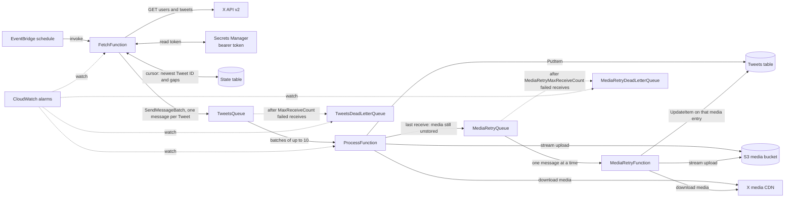

# Twitter Timeline Data Pipeline

A serverless pipeline on AWS that copies a public X (Twitter) account's timeline into your own storage. A scheduled Lambda function reads new Tweets from the X API v2 and puts one SQS message on a queue for each Tweet. A second Lambda function consumes the queue, writes each Tweet's metadata to DynamoDB, and streams attached photos and videos into S3. A third function stores media the second one could not store in time, through its own retry queue. The whole stack is one AWS SAM template, and the code is Python 3.14 managed with [uv](https://docs.astral.sh/uv/).

## Requirements

The project does the following:

- Authenticates to the X API v2 with a bearer token and collects a given user's timeline Tweets, each Tweet's metadata (`created_at`, `text`, `referenced_tweets`, and more), and any attached media.
- Uses Lambda, SQS, S3 and DynamoDB. A scheduled Lambda fetches and enqueues. A queue-triggered Lambda stores metadata in DynamoDB and media in S3.
- Is efficient, reliable and scalable: paginated fetches with media expanded inline, at-least-once delivery with repeatable writes, retries, a dead-letter queue, alarms, and bounded concurrency.
- Keeps the token in Secrets Manager.
- Is deployable from a YAML CloudFormation (SAM) template that creates the tables, bucket and queues, with a separate Python module for each Lambda function.
- Is documented, including the architecture, data models and assumptions (this file).

## Architecture



A run, step by step:

1. EventBridge invokes `FetchFunction` on the schedule (`rate(1 hour)` by default). The event may carry `{"username": "..."}`; otherwise the `TWITTER_USERNAME` setting is used. The name is normalized once (leading `@` removed, lower-cased) and used everywhere below.
2. The function reads the bearer token from Secrets Manager (cached in memory for 15 minutes), reads the account's cursor from the state table, and takes the user ID from it (the handle is looked up only when the stored ID is missing or older than `USER_ID_TTL_HOURS`; see [identity changes](#identity-changes)): the newest Tweet ID already fetched, plus any *gaps* (ID ranges known to be unfetched; see the [state table](#state-table-statetable)).
3. New Tweets first. It pages through `GET /2/users/:id/tweets` with `since_id` set to the newest ID, newest first, in pages of `MAX_RESULTS` Tweets. A first run has no `since_id`. `MAX_PAGES` is a budget of API requests, counting empty and failed ones; when gaps exist it is at least 2, one request is kept for the oldest gap, and the rest go to the new Tweets and the newest gaps.
4. Each page is first written, unchanged, to the media bucket under `raw/` (see [Raw API pages](#raw-api-pages)). Only then does it become one message per Tweet, sent to the queue with `SendMessageBatch` (10 at a time; only entries SQS reports as failed are retried, and not those failed with `SenderFault`: see [Quarantine](#quarantine)). A Tweet that fails to parse is quarantined and the rest of the page goes on. Each message carries the raw object's key as `raw_key`. If the upload fails, nothing from that page is enqueued and the run fails with its cursor unmoved, so the page is fetched again by the next run.
5. After each page is fully enqueued, the cursor is saved. While the page still has a `next_token`, the not-yet-fetched rest is recorded as a gap just below the lowest ID seen; a page without `next_token` closes it. So a run that hits the cap, a rate limit or an error leaves a gap, never a hole.
6. Then the gaps. Whatever remains of the shared `MAX_PAGES` budget goes to the gaps, newest gap first, with `since_id` and `until_id` set to the gap's bounds. Each saved page lowers the gap's `until_id`, and the gap is removed when a page has no `next_token`.
7. A 429 that resets later than the function will wait ends the run cleanly after saving: the invocation succeeds and the summary has `stopped_reason: "rate_limited"` (alerting on that comes with issue #19). Any other error fails the invocation, with progress up to the last full page saved; an error in one gap is raised only after the other gaps have had their turn. The next run resumes from the cursor and re-sends at most the page that was in flight.
8. SQS invokes `ProcessFunction` with batches of up to 10 messages (up to 10 seconds of batching, at most 5 concurrent invocations).
9. For each message it downloads the media and uploads it to S3, then writes the Tweet item to DynamoDB. Media goes first so a stored Tweet never points at missing media.
10. Messages that fail are reported back individually. SQS redelivers them and, after `MaxReceiveCount` receives, moves them to the dead-letter queue, which has an alarm.
11. On a message's last receive a media item that still can't be stored does not fail the record. The Tweet is written with that media marked `retrying` (with its `source_url`), and one message per such media item goes to the media-retry queue, delayed 5 minutes. `MediaRetryFunction` downloads the file and replaces just that entry of the Tweet item. If it keeps failing, the message ends up in the media-retry dead-letter queue, which also has an alarm. If the retry message cannot be sent, the record is reported failed and goes to the main DLQ instead.

## Data model

### SQS message

One message per Tweet. The body is compact UTF-8 JSON, with only the characters SQS rejects escaped (see **Size** below), and `"schema_version": 1`; the processor rejects any other version. This example is generated from the real model, with fake IDs:

```json
{
  "username": "nasa",
  "tweet": {
    "id": "1850000000000000001",
    "text": "Launch day. https://t.co/abc",
    "created_at": "2024-10-25T14:30:00.000Z",
    "author_id": "11348282",
    "conversation_id": "1850000000000000001",
    "lang": "en",
    "referenced_tweets": [],
    "public_metrics": {
      "retweet_count": 12,
      "reply_count": 3,
      "like_count": 150,
      "quote_count": 1
    },
    "edit_history_tweet_ids": ["1850000000000000001"],
    "media_keys": ["3_1850000000000000002"],
    "note_text": null,
    "entities": {
      "urls": [
        {
          "url": "https://t.co/abc",
          "expanded_url": "https://example.com/launch",
          "display_url": "example.com/launch",
          "start": 12,
          "end": 28
        }
      ]
    },
    "display_entities": null,
    "in_reply_to_user_id": null,
    "possibly_sensitive": null,
    "edit_controls": null,
    "withheld": null
  },
  "media": [
    {
      "media_key": "3_1850000000000000002",
      "type": "photo",
      "url": "https://pbs.twimg.com/media/EXAMPLE.jpg",
      "preview_image_url": null,
      "variants": [],
      "width": 1200,
      "height": 800,
      "duration_ms": null,
      "alt_text": null
    }
  ],
  "missing_media_keys": [],
  "referenced": [],
  "requested": {},
  "fetched_at": "2024-10-25T14:35:00Z",
  "schema_version": 1
}
```

You can regenerate it with `TweetMessage(...).to_json()` from `twitter_timeline_data_pipeline.models`.

**Long posts.** For a post over 280 characters the API's `text` is only a truncated preview; the full body is in `note_tweet.text`, which the fetch Lambda requests. It travels as `tweet.note_text` (`null` for a short post, and absent from messages queued by the old fetch Lambda). For a long post the stored `entities` are the ones of `note_tweet.entities` (their offsets index the full text); the Tweet-level ones, which index the preview, are kept as `display_entities` when the post is long. A long post whose note has no entities has no `entities` (the preview's offsets don't fit the full text): the preview's entities are its `display_entities`.

**Missing media.** A key in the Tweet's `attachments.media_keys` that the response's `includes.media` does not return (deleted or withheld media) is logged (`media key ... missing from includes`) and listed in `missing_media_keys`; the Tweet's `media_keys` still holds every attached key. The field is optional (absent means none were reported).

**Referenced posts and entities.** The fetch Lambda requests the `referenced_tweets.id` and `referenced_tweets.id.author_id` expansions, so the API returns the original of a retweet (whose own `text` is cut at about 140 characters, `RT @user: ...`), the quoted post and the post replied to under `includes.tweets`, and their authors under `includes.users`. Each message carries a compact copy of each in `referenced`: `{id, type, text, note_text, author_id, author_username, created_at, entities, status, unavailable_reason, note_text_omitted, entities_omitted}` (`note_text` for a long original, `status` and `unavailable_reason` below, the `*_omitted` markers see Size), and `requested` (`{"entities": bool, "expansions": bool}`: what the API was asked for, taken from the request's parameters, so a re-fetch can tell "none returned" from "not requested"; a message without it counts as nothing requested). A reference is marked `status: "unavailable"` only when the response's `errors` array names the post: an entry with `resource_id` equal to its ID and a `type` ending in `resource-not-found` (`unavailable_reason: "not_found"`, a deleted original) or `not-authorized-for-resource` (`not_authorized`, a protected one). Any other error, no error at all, an include whose `id` is unreadable or not a string, a non-list `includes.tweets` and an absent `includes` leave the reference bare (`{id, type}` only, no status), which never replaces a stored copy. The partial `errors` are logged as before. `tweet.entities` holds `urls` (`url`, `expanded_url`, `display_url`, `unwound_url`, `media_key`, `title`, `description`, `start`, `end`), `annotations`, `mentions` (`username`, `id`, offsets), `hashtags` and `cashtags` (`tag`, offsets); `tweet` also carries `in_reply_to_user_id`, `possibly_sensitive`, `edit_controls` and `withheld` when the API returns them. The media of referenced posts is not requested: `referenced_tweets.id.attachments.media_keys` is not in the endpoint's current expansion list in X's documentation (a possible flag later). Both requests can be turned off (`EXPAND_REFERENCED_TWEETS`, `REQUEST_ENTITIES`); with the expansion off the references are only `{type, id}` and carry no `status`. A reference is never dropped, and a stored copy is never erased by a fetch (see Assumptions and limitations).

**Compatibility.** `note_text`, `missing_media_keys`, `referenced` and the entity fields are additive, optional fields, so `schema_version` stays 1. A reader builds a Tweet from explicit keys and ignores unknown ones, so a processor from before this field still parses a new message (and stores the preview), and a new processor reading an old message gets `note_text = null` and no `missing_media_keys`. The version only changes for a change a reader cannot ignore.

**Size.** Each Tweet is one message, encoded as UTF-8. Only the characters SQS rejects or UTF-8 cannot encode (lone surrogates, U+FFFE, U+FFFF) are escaped, because escaping every non-ASCII character made emoji three to six times larger. The queues' `MaximumMessageSize` is 1 MiB (SQS's maximum; the dead-letter queue matches so redriven messages fit), and the fetch Lambda also groups messages so one `SendMessageBatch` call stays under 1 MiB in total. The worst case measured for the Tweet itself is about 450 KB, under the 1 MiB limit: a 25,000-weighted-character post of 35-byte emoji sequences (12,500 of them, such as woman, skin tone, heart, kiss mark, man, skin tone) with four photos whose alt text is 1,000 characters each. That text alone is over DynamoDB's 400 KB item limit, so when the estimated item size is over 350 KB the processor moves the text (and, if still needed, `display_text`) to S3 (see the Tweets table) and keeps the item under the limit. A long post that also replies to and quotes long posts measured 1,314,790 bytes with the originals' texts inline, over the limit. Entities can be as big: the worst case measured is a 25,000-weighted-character post with 1,000 links that have cards (`unwound_url`, `title`, `description`; one `entities` object is 754,754 bytes of JSON) quoting a similar post. Its message is 1,560,339 bytes. When a body is over the limit and the Tweet has a raw page, the fetch Lambda slims it in stages until it fits, with a WARNING: first the referenced posts' `note_text` (`note_text_omitted: true` on each copy; 1,535,340 bytes in the worst case, still over), then their `entities` (`entities_omitted: true`; 780,589 bytes, which fits), and only then the Tweet's own `entities` and `display_entities` (`tweet.entities_omitted: true`; 25,838 bytes). The processor reads what was left out back from the raw page named by `raw_key` (`response.includes.tweets[]` for the copies, `response.data[]` for the Tweet) before writing, with the same parser, so nothing is lost and the run does not stall. Posts of the page that the envelope's `redactions` list are not restored (a redacted original comes back as a bare reference). A record whose raw page or content cannot be read is retried until its last receive (`MaxReceiveCount`); on the last receive the Tweet is stored with what the message has instead (the omitted markers are kept on the stored copy, and a slimmed or omitted value never replaces richer stored data, see Assumptions and limitations), and a replay of the raw page fills the rest in. The slimmed copy of this Tweet in DynamoDB is under the item limit the same way: when the estimated item is still over 350 KB after the texts have moved to S3, the entities move too, largest first (the worst case ends at an estimated 4,772 bytes, with two 25,002-byte texts and two 754,754-byte entities objects in S3). A replay of pages from a bucket other than the configured `MEDIA_BUCKET` refuses, with an error, a message that would need slimming, because the processor reads raw pages from its own bucket only. A body still over the limit, or over it with no raw page (`--no-raw`, or no bucket), stops the run with `MessageTooLargeError` instead of dropping data: the checkpoint is not advanced and the Lambda's Errors alarm fires.

**Field name.** X's docs and OpenAPI spec show a `post.fields` / `note_post` rename in progress. `Tweet.from_api` reads `note_tweet` and falls back to `note_post`, but the request still asks for `note_tweet`: run a smoke test with a real token before deploying to confirm long posts come back with their full text.

### Tweets table (`TweetsTable`)

| Item | Value |
| --- | --- |
| Partition key | `tweet_id` (S) |
| GSI `username-created_at-index` | partition `username` (S), sort `created_at` (S), projects `text`, `text_truncated`, `text_s3_key`, `media_count` and `public_metrics` only |
| Billing | on demand; point-in-time recovery and encryption on |

`created_at` is stored as the API's ISO 8601 string, which sorts chronologically. The index projects `INCLUDE` rather than `ALL`: that roughly halves its write units and storage per Tweet. The trade-off is that a listing returns only those five attributes plus the keys, so read anything else (`media`, `referenced_tweets`, ...) with `GetItem` on `tweet_id`. The projected `text` is the full text for a long post (the preview is `display_text`, which the index does not project) unless the item was offloaded: then it is only a prefix, so check `text_truncated` and read the full text from `text_s3_key`. Attributes written by `TweetStore.to_item` (attributes whose value is `None` are omitted):

| Attribute | Type | Notes |
| --- | --- | --- |
| `tweet_id` | S | Tweet ID |
| `username` | S | Normalized account name (lower case) |
| `author_id` | S | |
| `text` | S | The full text; for a long post, `note_tweet.text`. When `text_truncated` is `true`, only the first 2,000 characters (a lone surrogate shown as U+FFFD) |
| `text_truncated` | BOOL | Only present (`true`) when the text was moved to S3 because the item would be near DynamoDB's 400 KB limit (estimated over 350 KB), or because it holds a lone surrogate, which DynamoDB can't store |
| `text_s3_key` | S | Only with `text_truncated`: the S3 key of the full text |
| `display_text` | S | Only for a long post: the API's truncated preview |
| `display_text_truncated`, `display_text_s3_key` | BOOL, S | The same for `display_text`, in the rare case it is the big field |
| `is_long_post` | BOOL | `true` when the post has a `note_tweet`, else `false`. Absent on items written before this field existed, and `false` for messages queued by the old fetch Lambda |
| `created_at` | S | ISO 8601 |
| `conversation_id` | S | |
| `lang` | S | |
| `referenced_tweets` | L of M | `{type, id}`; type is `retweeted`, `quoted` or `replied_to`. With the expansion on, also the original's `text` (full: for a long post `note_tweet.text`, with `display_text` the preview and `is_long_post: true`), `author_id`, `author_username` and `created_at`; `status` is `unavailable` only for a post the API's `errors` named as not found or not authorized (`unavailable_reason` `not_found` or `not_authorized`, `unavailable_since` the first fetch that saw it so, carried forward and cleared when the original is back); the stored copy stays whole. A referenced text is moved to S3 like `text` (`text_truncated`, `text_s3_key` in the entry; key `text/<author_id>/<tweet_id>.ref.<referenced_id>.json`) when the item is still near the size limit after `text` and `display_text` have been moved. A copy's `entities` can be moved to S3 as well (`entities_s3_key` in place of `entities`). `note_text_omitted` and `entities_omitted` (`true`) mark a copy stored without what a failed read-back would have restored. A later fetch with a bare reference keeps these fields and adds `stale_since` and `last_seen_fetched_at`; a stored reference the new item does not list is kept after the new ones with `missing_since` and `last_seen_fetched_at` (see Assumptions and limitations) |
| `entities` | M | Of the text stored in `text`: `urls[]` (`url`, `expanded_url`, `display_url`, `unwound_url`, `media_key`, `title`, `description`, `start`, `end`), `mentions[]` (`username`, `id`, `start`, `end`), `hashtags[]` and `cashtags[]` (`tag`, `start`, `end`), `annotations[]` (`probability` is a number stored exactly). Absent when the Tweet has none or `REQUEST_ENTITIES` is off. When the item is still near the size limit after the texts moved to S3, it is moved to S3 as JSON too and replaced by `entities_s3_key` (`text/<owner>/<tweet_id>.entities.<hash>.json`, the hash being the first 16 hex characters of the SHA-256 of the content, so a key always holds what the item expects). A number outside DynamoDB's range (about 1E-130 to 9.99E+125 in magnitude) is stored as its `repr` string, and a subtree nested deeper than DynamoDB's 32 levels (in `entities`, `withheld` or `edit_controls`) is stored as its JSON text |
| `display_entities` | M | Only for a long post: the Tweet-level entities, which index the preview in `display_text` (or `display_entities_s3_key`, as for `entities`). `entities_omitted` (`true`) on the item marks entities left out of an oversized message that could not be read back |
| `in_reply_to_user_id` | S | |
| `possibly_sensitive` | BOOL | |
| `edit_controls` | M | `edits_remaining`, `is_edit_eligible`, `editable_until` as returned |
| `withheld` | M | `copyright`, `country_codes`, `scope` as returned |
| `public_metrics` | M | retweet, reply, like and quote counts at fetch time |
| `edit_history_tweet_ids` | L of S | |
| `media_keys` | L of S | every media key the Tweet attaches, in the API's order, including keys the API did not return (see `missing` below) |
| `media` | L of M | one entry per key in `media_keys` (below) |
| `media_count` | N | `len(media_keys)`: the attached media, not only the downloaded ones |
| `fetched_at` | S | when the fetch Lambda saw the Tweet; a write is skipped if the stored value is later |
| `stored_at` | S | when the item was written |
| `schema_version` | N | a write is skipped if the stored value is higher |
| `revision` | N | incremented by every write; guards the read-merge-write of `put_tweet` |

**Reading the full text.** Use `text` unless `text_truncated` is `true`; then `GetObject` the key in `text_s3_key` from the media bucket (`text/<author_id>/<tweet_id>.json`, or the lower-cased username when the Tweet has no author ID) and `json.loads` it: the object is the text as one JSON string (UTF-8, `application/json`), so any characters, a lone surrogate included, read back exactly. The object is written before the item and create-only, so a redelivery leaves it alone. Only a post whose item would pass 350 KB is offloaded (a handful of emoji-only posts at most). A message without `note_text` never replaces a stored long post, whatever its `fetched_at`.

Each `media` entry has `media_key`, `type`, `status` and, when known, the storage outcome (`s3_key`, `content_type`, `source_url`, `size_bytes`, `preview_s3_key`, `preview_status`, `preview_size_bytes`) and the media's own fields as the API gave them: `url` (as given: a stored photo's `source_url` is the `name=orig` rewrite), `alt_text`, `width`, `height`, `duration_ms`, `preview_image_url` and `variants` (a list of `{content_type, bit_rate, url}`; `bit_rate` only when given). Absent values are omitted. Integers are clamped to +-(2^63 - 1). A key whose media the API did not return has `type` `unknown`, status `missing` and nothing else.

`status` is one of: `stored` (uploaded now) and `exists` (already in S3), both with `s3_key`; and, without a file in S3, `unavailable` (the source answered 4xx other than 429, or redirected), `skipped` (nothing to download: no URL, or one that isn't https on an X media host), `skipped_hls` (a video or animated GIF whose only variants are HLS playlists, so there is no file; the poster frame is still stored), `too_large` (over `MAX_MEDIA_BYTES`; `size_bytes` is the estimate or the byte count where the download was stopped), `missing` (see above) and `retrying` (transient errors persisted through the message's last receive, so the Tweet was written without the file or poster frame; `source_url` and the planned `s3_key` and `preview_s3_key` are recorded and a media-retry message is queued). `retrying` is not final: `MediaRetryFunction` replaces the entry with `stored`, `exists`, `unavailable`, `too_large`, `skipped` or `skipped_hls` once it has dealt with the media. An entry still `retrying` means the retry is pending, or (after the media-retry dead-letter queue alarm) failed and awaits an operator; the `source_url` says what to fetch.

`preview_s3_key` is the stored poster frame of a `video` or `animated_gif` that has an allowed `preview_image_url` (`media/<author_id>/<tweet_id>/<media_key>_preview.jpg`). It is downloaded the same way as the file (size cap, time budget, host allowlist, no redirects, an existing object is not fetched again) and is part of the same retry unit: a transient failure retries the whole record, and on the last receive the entry becomes `retrying` and the retry consumer stores both. `preview_status` records how the poster frame ended: `stored`, `exists`, `unavailable`, `too_large` (with `preview_size_bytes`, the estimate or count) or `retrying`. A poster frame that is permanently unavailable or too large has no `preview_s3_key` and the status stays that of the file. An entry that is `retrying` only for its poster frame has no `source_url` for it: the source is `preview_image_url`. **Re-fetches never erase media.** Every `put_tweet` first reads the stored item (consistent) and merges it in: a stored entry whose key a newer fetch lacks (`missing` in `includes.media`, or not listed at all) is kept whole, with `missing_since` (the fetch that first lost it) and `last_seen_fetched_at` added. Only a key that was never seen is written as `missing`; a fetch that has the media again replaces the entry as usual. The put is conditional on the item's `revision` (a number every write increments, `media_retry`'s update included; any other in-place updater must `ADD revision 1` too). If another write lands in between, it re-reads and merges again, up to 3 times; after that it raises `WriteContentionError`, the record fails and SQS redelivers it (the DLQ alarm covers the last receive), so nothing is dropped as stale. When first deploying this version, let the media-retry queue drain (or disable `MediaRetryFunction`'s event source) during the deploy: a retry still running the previous code doesn't bump `revision`, so in that one-off window its result could be overwritten by a concurrent merge.

**Legacy items** (written before this) have no `media_keys`, their `media_count` counts the stored entries only (a key the API omitted was dropped), and an HLS-only video says `skipped` rather than `skipped_hls`.

Every S3 object of an item is named by the item: `s3_key` and `preview_s3_key` of each `media` entry, `text_s3_key` and `display_text_s3_key`, and, for each entry of `referenced_tweets`, its own `text_s3_key` and `display_text_s3_key` (objects `text/<owner>/<tweet_id>.ref.<referenced_id>[.display_text].json`). These objects live under `text/<owner>/<tweet_id>.`, the item's own prefix, so the compliance job's prefix purge (issue #21) covers them. A write never deletes an object (the process function has no `s3:DeleteObject`): an object that an older version of the item pointed at stays in place, and a key that holds JSON entities carries a hash of its content.

### Media-retry message (`MediaRetryQueue`)

One message per media item left `retrying`. The body is compact UTF-8 JSON with its own `kind`, so it cannot be mistaken for a Tweet message (which has no `kind`, and is rejected by the retry consumer) and `"schema_version": 1`:

```json
{
  "kind": "media_retry",
  "schema_version": 1,
  "tweet_id": "1850000000000000001",
  "username": "nasa",
  "author_id": "11348282",
  "fetched_at": "2024-10-25T15:00:00Z",
  "media": {
    "media_key": "7_1850000000000000002",
    "type": "video",
    "variants": [{"content_type": "video/mp4", "url": "https://video.twimg.com/a.mp4", "bit_rate": 832000}],
    "duration_ms": 12000
  }
}
```

`media` has the shape of an entry of the Tweet message's `media`. The consumer reads the Tweet item (`GetItem`, strongly consistent) to find the index of the entry with that `media_key`, stores the file with the same deterministic S3 key as the process function (an object that already exists is not downloaded again), and then replaces `media[index]` with a conditional `UpdateItem` that applies only if the item exists, the entry at that index still has the same `media_key` and its status is still `retrying`. If that condition fails, another delivery already settled the entry (or a newer fetch rewrote the item) and the message is done. Permanent results (`unavailable`, `too_large`, `skipped`) update the entry the same way and finish. Anything else (a transient download error, a Tweet item that isn't written yet, a malformed message, running out of time) reports the record as failed, so SQS redelivers it and, after `MediaRetryMaxReceiveCount` receives, moves it to the media-retry dead-letter queue. The queue has a visibility timeout of 5,400 s (6 times the consumer's 900 s timeout), so retries are at least that far apart; a message lives up to 14 days.

### State table (`StateTable`)

One item per account: partition key `username` (S, lower case) and

| Attribute | Type | Meaning |
| --- | --- | --- |
| `newest_id` | N | Highest Tweet ID reached by the new-Tweets phase (a gap page can enqueue a higher one, which is re-fetched later). Never decreases. Absent until the first Tweet. |
| `gaps` | L of M | Exclusive ID ranges known to be unfetched, each `{until_id, since_id, empty_runs, first_empty_at}` (N; `empty_runs` and the ISO-8601 UTC `first_empty_at` only when `empty_runs` is above 0). A missing `since_id` means "down to the end of what the API serves" (about the 3,200 most recent posts); a missing `until_id` means "up from the newest Tweet". |
| `user_id` | S | Numeric user ID the handle resolved to. Absent on items written before this existed (the next run looks the handle up, logs the binding and stores it). |
| `user_id_resolved_at` | S | ISO-8601 UTC time (`...Z`) the ID was last confirmed by a lookup (only a lookup sets it; an unreadable or timezone-less value counts as expired). The ID is reused until it is `USER_ID_TTL_HOURS` old, then looked up again (and this time refreshed if unchanged). |
| `version` | N | Optimistic lock, incremented on every write. |
| `updated_at` | S | UTC timestamp of the last write. |

The list is kept normalized on every save: overlapping or adjacent gaps are merged, and at most 1,500 are kept (past that, the two closest neighbours are joined; the cap covers a day of one standing empty gap per run at a 1-minute schedule, about 165 KB against DynamoDB's 400 KB item limit). A merge only adds IDs to re-fetch, so it can cause duplicates but never loss.

**Empty responses never end a range by themselves.** A `200` with `errors` and no data (for example an account that turned protected) raises an error instead of reading as "no more Tweets"; an empty page that still has a `next_token` is followed. A gap is dropped only after 3 consecutive empty runs spanning at least 24 hours (`empty_runs`, `first_empty_at`), so a short API incident cannot erase a range that still holds data. A run counts as empty when no page for the gap carried data and the walk ended on a clean empty response (no data, no errors, no `next_token`; empty pages that still pointed onward don't prevent it). Both fields reset whenever data comes back. Because the API sends a `next_token` on the last page, every run's new-Tweets walk ends on such an empty response, which is recorded as the gap's first empty run without a second request. A gap that has reached its last run waits out the 24 hours without being asked again (it costs no requests and doesn't count as unfinished), then gets one request first in its next run to drop. Gaps that came back empty are checked after the ones that may still hold Tweets, so a burst isn't starved by them. If the API recovers during the wait, the Tweets in such a gap arrive at the end of it, delayed but not lost. The drop is logged at WARNING as `dropping gap for <user> (since_id=..., until_id=...): out of the API's reach`, stable text for a metric filter to match. That is how a range that has aged out of the API's window finally goes away.

Every write is conditional on the `version` that run read (a missing `version` counts as 0, so items written before gaps existed are read as they are and upgraded on the first write). If another run got there first, the write fails, the run stops fetching, logs a warning and returns `stopped_reason: "state_conflict"`. Anything it already enqueued is a harmless duplicate, `newest_id` never moves backwards, and no gap is dropped.

#### Identity changes

The checkpoint belongs to the account, not just the handle. If the account renames and someone else registers the old handle, a lookup returns a different user ID. Whenever a lookup (or the `user_id` in the fetch event) differs from the stored `user_id`, the run raises `IdentityChangedError` and the invocation fails (so the `Errors` alarm fires). It logs at ERROR, stable text for a metric filter to match: `identity changed for handle <handle>: stored user_id <old>, now <new>; nothing ingested`. The lookup happens when the stored ID is missing or older than `USER_ID_TTL_HOURS`, so a takeover is caught at the next expiry (up to 24 h by default); until then the cached ID keeps reading the original account, never the new owner. A timeline response of "user not found" for a cached ID also triggers a fresh lookup with the same check. No Tweet of the new owner is ever enqueued. On a lookup-time change nothing is enqueued and the state is untouched. On the cached-ID not-found path, pages enqueued earlier in that run stay enqueued and a backfill requested by the event has already been saved; nothing is lost or attributed to the wrong account. A CloudWatch metric and alarm on that log text is planned (#19); until then the failed invocation is the signal.

The first time a handle is tied to an ID (a new account, an item from before `user_id` existed, or one whose `user_id` was removed) the run logs a WARNING, `binding handle <handle> to user_id <id> (no user ID was stored)`. That is the one moment a takeover could not be told apart from the account itself, so check it is the account you mean.

**Runbook after an identity change (or when the old handle is freed).** The schedule carries no input, so every run keeps using `TwitterUsername`. The old handle's state item is what catches the takeover: never delete it or its `user_id`, or the next run binds the handle to its new owner and ingests that person's posts.

1. Stop the bleeding first: either set `TwitterUsername` to the account's new handle and redeploy, or disable the schedule (`ScheduleState=false`).
2. Optionally carry the cursor over so the new handle does not refetch everything. Read the old item, then write a new item under the new handle (lower case) with the same `newest_id`, `gaps` and `user_id` (set `user_id_resolved_at` to now, `version` to 1):

   ```bash
   aws dynamodb get-item --table-name "$STATE_TABLE" --consistent-read \
     --key '{"username": {"S": "<old handle>"}}'
   aws dynamodb put-item --table-name "$STATE_TABLE" --item '{
     "username": {"S": "<new handle>"}, "user_id": {"S": "<original id>"},
     "user_id_resolved_at": {"S": "<now, e.g. 2026-10-01T12:00:00Z>"},
     "newest_id": {"N": "<newest_id>"}, "gaps": {"L": []}, "version": {"N": "1"}}'
   ```

   Copy `gaps` as read (or `[]` to drop them). Without this step the new handle starts from scratch and fetches the account's most recent ~3,200 posts, as a first run does. Stored Tweets are not affected either way.
3. If the old handle is simply freed (nobody took it), runs after the TTL expires fail with a not-found error until you do step 1; the cached ID is used until then.
4. If you really want the handle's new owner under the old handle, that is a new account for this pipeline: use a different state table or the new-handle approach above, not the old item.

The event may carry `"user_id": "<numeric id>"` as an assertion: it must equal the stored ID, and when none is stored the handle is looked up and must resolve to it (otherwise `IdentityChangedError`). It never replaces a lookup, so it cannot bind a handle to an ID the handle does not have. The CLI `--dry-run` has no state table and resolves the handle on every call.

### S3 media bucket

Key layout:

```text
media/<author_id>/<tweet_id>/<media_key><extension>
```

If a Tweet has no `author_id`, the lower-cased username is used instead. The key is deterministic, so a repeat delivery finds the object and skips the download. Photos are fetched at original size (`name=orig`, other query parameters are kept). For videos and animated GIFs, the highest-bit-rate `video/mp4` variant is stored, and the poster frame (`preview_image_url`) goes next to it as `media/<author_id>/<tweet_id>/<media_key>_preview.jpg`.

The same bucket also holds the full text of oversized long posts at `text/<author_id>/<tweet_id>.json` (a JSON string, `application/json`, user metadata `tweet-id`); see the Tweets table. These objects are not tiered.

Each object has the `Content-Type` of the source and user metadata `tweet-id`, `media-key` and `source-url`. The bucket is encrypted (SSE-S3), blocks all public access, refuses non-TLS requests, and aborts incomplete multipart uploads after 7 days. Versioning is on, so a deleted or overwritten object can be recovered for 30 days (noncurrent versions under `media/` and `text/` then expire; `raw/` versions never do). Objects under `media/` move to S3 Intelligent-Tiering on day 0, so cold video stops costing Standard rates; the trade-off is a small per-object monitoring fee, and objects under 128 KB are never tiered.

## Design decisions

- **`GET /2/users/:id/tweets`.** It returns an account's own Tweets and works with an app-only bearer token (the home timeline endpoint needs user-context OAuth). One request returns up to 100 Tweets with their media expanded, instead of one lookup per Tweet, which keeps API usage low.
- **At-least-once, with repeatable writes.** SQS can deliver a message twice, and a failed fetch run is re-run from the old checkpoint. Tweets are written with a conditional `PutItem` keyed by `tweet_id`: the write succeeds only if there is no item yet, or the stored `fetched_at` (if any) is not later than the message's and the stored `schema_version` is not higher (a legacy item without one counts as older). The latest fetch wins, not the latest delivery, so a stale redelivery (for example a DLQ redrive of an old message) cannot overwrite newer data such as `public_metrics`. `fetched_at` is an ISO 8601 UTC string with second precision, which compares chronologically as a string; an equal `fetched_at` rewrites the same data, so redelivery stays idempotent. A skipped stale write counts as processed: it is logged at INFO (`stale write skipped for tweet ...`), not retried and not sent to the DLQ. Media keys are deterministic and existing objects are not downloaded again.
- **Cursor after enqueue, per page.** The cursor is saved only after a page's messages are enqueued, so a failed run re-sends at most the page in flight (harmless duplicates) rather than losing any, and a capped or failed run leaves a recorded gap instead of a hole.
- **Overlapping fetch runs are harmless.** The fetch function has no reserved concurrency. The cursor write is conditional on a version, so a run that lost a race stops instead of overwriting, and duplicate messages are handled by idempotent processing.
- **Partial batch responses, DLQ and alarms.** `ProcessFunction` returns the IDs of failed records, so one bad message does not retry the other nine. Transient media errors (timeouts, 429, 5xx) fail the record for retry, until its last receive (see below). Malformed messages and unexpected errors fail it too and end up in the DLQ after `MaxReceiveCount` receives (kept 14 days). `MediaRetryFunction` works the same way on its own queue (`BatchSize` 1): a failed retry is redelivered and ends up in the media-retry DLQ after `MediaRetryMaxReceiveCount` receives. Alarms cover a non-empty DLQ, a non-empty media-retry DLQ, fetch errors (1 hour window) and whole-invocation process errors (5 minute window). Because of partial batch responses, a failed record is not a Lambda `Errors` datapoint, so the two DLQ alarms are the signal for record-level failures. DLQ messages expire after 14 days. Set `AlarmTopicArn` to get notified through SNS.
- **A media failure on the last receive is queued, never dropped.** On a message's last receive (`MaxReceiveCount`) the process function does not fail the record for media it cannot store. For each such media item it runs the cheap checks first (not an allowed source: `skipped`; too big by estimate: `too_large`; already in S3: `exists`; a poster frame not yet in S3 keeps the entry `retrying` whatever the file's own result), and records what it still cannot store as `retrying` with its `source_url`. It writes the Tweet and then sends one message per `retrying` item to the media-retry queue. If a send fails, the record is reported failed instead and goes to the main DLQ (alarm), so a retry is never lost silently. It does not send retries when its write was skipped as stale, since the newer item has its own media state. Retries can duplicate (a redelivered Tweet message may queue them again); the consumer's conditional update makes that harmless.
- **Streaming uploads.** Media is downloaded only over https from `pbs.twimg.com` and `video.twimg.com` (message bodies are treated as untrusted), redirects are not followed, and the file is streamed from the CDN straight into S3 `upload_fileobj` through a small file-like adapter, so a large video is never held in memory.
- **Least-privilege IAM.** The fetch function can send to its queue, read one secret, and get/put items in the state table. The process function can write to the tweets table, put/get objects in the bucket and list it (so a missing key is a 404, not a 403), and send to the media-retry queue only. The media-retry function can get and update items in the tweets table (no `PutItem`) and put/get/abort/list on the bucket; it has no SQS permissions beyond its event source. None can touch the others' resources.
- **Secrets handling.** The stack creates an empty secret, so the token is never in the template, a parameter or an environment variable. `scripts/put_secret.sh` fills it in without putting the token in the process arguments. The fetch function only gets the secret's ARN. It caches the token for 15 minutes, so a rotated secret is picked up without a redeploy, and drops the cache on a 401/403. The token is sent only in the `Authorization` header and is excluded from log output and `repr`. The AWS SDK and HTTP library loggers (`botocore`, `boto3`, `s3transfer`, `urllib3`, `httpcore`, `httpx`) are held at WARNING even when `LogLevel` is `DEBUG`, since at DEBUG they can log secret values.
- **Retained data stores.** The tweets table and the media bucket have `DeletionPolicy: Retain`, so deleting the stack does not delete collected data.
- **No automatic fetch retries.** The function has `MaximumRetryAttempts: 0`, because the next scheduled run is the retry and a retry would only use up API rate limit.
- **Runtime.** Python 3.14 on arm64 (Graviton). The dependency bundle is built for `aarch64-manylinux_2_28` wheels so it can be built on any machine.

### Raw API pages

Every timeline page the fetch receives is kept as it came from the API, so a field the processor doesn't store today (`note_tweet`, `entities`, referenced posts) can be recovered later without calling the API again; the API serves only an account's 3,200 most recent posts, so for older posts this is the only chance. The fetch writes the page to the media bucket before enqueuing its messages. An empty page that still points to a next page is landed too; a clean empty response (no data, no next page) is not.

```text
raw/<user_id>/dt=YYYY-MM-DD/<run_id>-<page_no>.json.gz
```

`dt` is the UTC date of the fetch, `run_id` a random ID per fetch run and `page_no` the page's number within that run, from 0001. Keys are unique, so nothing is overwritten. The object is gzipped JSON (`Content-Type: application/json`, `Content-Encoding: gzip`), an envelope:

```json
{
  "schema_version": 1,
  "username": "nasa",
  "user_id": "1000000001",
  "fetched_at": "2026-10-25T08:30:00Z",
  "request": {"endpoint": "/users/1000000001/tweets", "params": {"max_results": 100, "...": "..."}},
  "response": {"data": ["..."], "includes": {"media": ["..."]}, "meta": {"next_token": "..."}}
}
```

`request.params` holds the query parameters (the bearer token is a header and is never stored); `response` is the body as received. `fetched_at` is the same value the page's messages carry. Each message has an optional `raw_key` (additive, `schema_version` stays 1) and the Tweet item stores it as `raw_key`, so any item can be traced to the page it came from.

Pages are written once (`If-None-Match: *`; an existing key is the same page from an earlier attempt and is left alone). The `FetchFunction` role may only `s3:PutObject` under `raw/*` and `quarantine/*` (see [Quarantine](#quarantine)), and `ProcessFunction` may write `media/*` and `text/*`, delete under `text/*` (the text of an original that became unavailable) and only read `raw/*` (to fill in referenced note texts left out of an oversized message), so no function can overwrite or delete a raw page. No lifecycle rule touches `raw/`: nothing is expired, and noncurrent versions are expired only under `media/` and `text/`. There is no storage-class transition either: gzipped pages are far below the 128 KB minimum S3 applies to lifecycle transitions, so one would do nothing. The pages are encrypted, private and versioned like the media.

A page the parser rejects (valid JSON of an unexpected shape) is landed first and then fails the run with the cursor unmoved, so the data is kept and can be replayed once the parser is fixed.

**Retention and deletion.** A raw page holds up to 100 Tweets, so it cannot be deleted for one Tweet. It is kept indefinitely. Deletions in `raw/` belong to the compliance job of issue #21: it rewrites the affected pages to remove deleted Tweets and records their IDs in an optional envelope field `redactions` (a list of Tweet IDs). `replay` never replays a Tweet listed in `redactions`, nor media used only by it.

### Quarantine

Nothing is dropped, and one bad item doesn't block an account. Parsing is per item: a Tweet (or an `includes.media` object) that fails to parse, for example a `null` metric, is *quarantined* and the rest of the page is enqueued. A bad media object is treated as missing for its Tweet, which is still stored. The cursor may move past a quarantined Tweet because it is kept twice: in the raw page and in a quarantine object. A Tweet whose `id` is not a decimal string counts as unparseable. A quarantined Tweet's ID moves the cursor only when it lies inside the page's own ID range (its parsed Tweets and `meta.oldest_id`..`newest_id`); otherwise it is treated as having no ID, so a bogus ID can't skip real Tweets.

```text
quarantine/<user_id>/dt=YYYY-MM-DD/<run_id>-<page_no>-<index>.json
```

Each object is plain JSON (`application/json`): `{"kind": "tweet" | "media" | "included_tweet" | "included_user" | "message", "raw_key": "<the raw page>", "error": "...", "item": <the JSON as received>}`. `run_id` and `page_no` match the raw page's key (`index` counts the page's quarantined items from 000). A `message` is an SQS message body that SQS rejected with `SenderFault` (a body SQS refuses as invalid; one over the size limit never gets that far, it fails the page first): such an entry would fail the same way again, so it isn't retried, it is quarantined and the run goes on. Entries that failed for other reasons are still retried, and `EnqueueError` is raised if they keep failing.

If a quarantine write fails (or there is no media bucket to write to: `fetch --no-raw` without `MEDIA_BUCKET` is unsafe for malformed pages, they fail the run), the page fails like a failed raw upload and the cursor stays, so the next run fetches it again. For an unparseable Tweet or media object nothing from the page is enqueued, because those are written before any message is sent. For a `message` object, messages sent earlier in the page stay enqueued; the re-send is a harmless duplicate. The `FetchFunction` role may `s3:PutObject` under `quarantine/*` only.

Every quarantined item logs a stable line: `unparseable <kind> quarantined: id=... error=...` (ERROR, when parsed) and `quarantined <kind>: key=... raw_key=... error=...` (WARNING, when written). Errors alongside data log `timeline page N has K partial error(s); first: ...` (WARNING). Metrics and alarms for unparseable or quarantined items and for partial errors come with issue #19; until then these log lines are the signal.

**Inspect and recover.** List and read the objects with `aws s3 ls "s3://$BUCKET/quarantine/$USER_ID/" --recursive` and `aws s3 cp <key> -`. To recover Tweets and media, fix the parser, then replay the raw prefix: `twitter-pipeline replay --raw s3://$BUCKET/raw/<user_id>/dt=.../` (see [Replay raw pages](#replay-raw-pages)). Replay re-parses the raw pages with the fixed code, so the formerly quarantined items are parsed this time; anything that still fails is quarantined again, with the replay's own run ID. For a `message` object, `item` is the message body: fix the cause and send it with `aws sqs send-message --queue-url "$QUEUE" --message-body "$(aws s3 cp <key> - | jq -c .item)"` (`item` is the parsed body, so `jq -c .item` turns it back into one JSON line).

**Errors-only responses.** A 200 with `errors` and no `data` is never read as an empty timeline. It raises a typed error and the run fails: `AccessError` for the problem type `not-authorized-for-resource` (e.g. the account went protected), `NotFoundError` for `resource-not-found`, a plain `XApiError` for any other.

## Repository layout

```text
.
├── template.yaml                      SAM/CloudFormation template for the whole stack
├── samconfig.toml                     sam deploy defaults (stack name, region, capabilities)
├── pyproject.toml, uv.lock            package metadata and locked dependencies
├── renovate.json                      dependency update configuration
├── LICENSE                            GPL-3.0
├── .github/workflows/ci.yml           CI, release and optional PyPI publish
├── .python-version                    3.14
├── events/
│   ├── fetch.json                     sample event for FetchFunction
│   └── sqs.json                       sample SQS event for ProcessFunction
├── scripts/
│   ├── build_lambda.sh                build build/lambda/ for Python 3.14 on arm64
│   ├── deploy.sh                      build, then sam deploy
│   ├── integration_test.sh            run the integration tests with Docker (see below)
│   ├── check_iam.sh                   offline IAM policy check of the template
│   ├── expand_sam_template.py         expand the SAM transform (used by check_iam.sh)
│   ├── put_secret.sh                  store the bearer token in Secrets Manager
│   └── delete.sh                      delete the stack
├── src/twitter_timeline_data_pipeline/
│   ├── config.py                      settings read from environment variables
│   ├── credentials.py                 bearer token lookup and TTL cache
│   ├── x_api.py                       X API v2 client (retries, rate limits, pagination)
│   ├── models.py                      Tweet, Media, SQS messages (schema_version 1)
│   ├── raw.py                         raw API pages: envelope, S3 keys, writer, reader
│   ├── quarantine.py                  quarantine objects: key layout and writer
│   ├── replay.py                      rebuild messages from raw pages (no API calls)
│   ├── storage.py                     DynamoDB and S3 persistence, checkpoint store
│   ├── cli.py                         `twitter-pipeline` command
│   └── handlers/
│       ├── fetch.py                   FetchFunction handler
│       ├── process.py                 ProcessFunction handler
│       └── media_retry.py             MediaRetryFunction handler
└── tests/                             moto-mocked tests, no AWS account needed
    ├── system/                        in-process simulation of the event source mapping and DLQ
    └── integration/                   built bundle in the Lambda runtime image, with LocalStack
```

## Local development

The project is pinned to Python 3.14 in `.python-version`. Install [uv](https://docs.astral.sh/uv/getting-started/installation/); it downloads Python 3.14 if you don't have it.

```bash
uv sync                      # create .venv with runtime and dev dependencies
uv run pytest                # tests
uv run ruff check .          # lint
uv run ruff format --check . # formatting
uv run mypy                  # strict type check of src/
uv build                     # build the sdist and wheel into dist/
```

## Continuous integration and releases

`.github/workflows/ci.yml` runs on every pull request, on pushes to `main` and on `v*` tags. Each job installs uv and uses the locked dependencies (`uv sync --locked`).

| Job | What it runs |
| --- | --- |
| Lint | `uv lock --check` (lockfile is current) and `ruff check` |
| Format | `ruff format --check` |
| Type check | `mypy` (strict) |
| Test | `pytest` with coverage on Python 3.14 and 3.15; 3.15 shows readiness for the next Lambda runtime. JUnit and coverage reports are uploaded as artifacts |
| Validate template | `cfn-lint template.yaml`, `shellcheck scripts/*.sh`, and the offline IAM check (`scripts/check_iam.sh`; see [IAM policy validation](#iam-policy-validation)) |
| Build | After all of the above: `uv build`, a smoke test of the wheel in an isolated environment (import, `--help`, `--version`), and the Lambda bundle zipped as `twitter_timeline_data_pipeline-<version>-lambda-arm64.zip` |
| Integration | After Build: runs the Lambda zip that Build produced in the real Lambda runtime image against LocalStack (see [Integration tests](#integration-tests)) |
| GitHub Release | On `v*` tags only, after Build and Integration: checks the tag, then creates the release |

### Cutting a release

Versions follow [semantic versioning](https://semver.org). The version lives in `pyproject.toml`, and the tag must match it.

```bash
uv version --bump patch      # or minor, or major
git commit -am "release v$(uv version --short)"
# open a PR, let CI pass, merge it, then from an up-to-date main:
git tag "v$(uv version --short)"
git push origin "v$(uv version --short)"
```

For a prerelease, add a second bump: `uv version --bump minor --bump rc` gives `0.2.0rc1`, and `uv version --bump rc` moves to `0.2.0rc2`. `uv version --bump stable` drops the suffix. uv writes prereleases in Python's spelling (`0.2.0rc1`) and the tag uses the semver spelling (`v0.2.0-rc.1`; `-alpha.N` and `-beta.N` work the same way). The release job maps one to the other.

The release job fails unless the tag is valid semver (`vMAJOR.MINOR.PATCH`, optionally `-prerelease`, no leading zeros) and equals the version in `pyproject.toml`. It then creates a GitHub Release with generated notes and attaches the wheel, the sdist and the Lambda zip. A tag with a prerelease suffix is marked as a prerelease.

### Publishing to PyPI (off by default)

This repository is private, and publishing to PyPI would make the package public, so GitHub Releases are the distribution channel. The `publish-pypi` job runs after the release job and only when the repository variable `PUBLISH_TO_PYPI` is `true`. To enable it:

1. On PyPI, add a trusted publisher for this repository with workflow `ci.yml` and environment `pypi`.
2. Create the `pypi` environment in the repository settings, ideally limited to `v*` tags with required reviewers.
3. Set the repository variable `PUBLISH_TO_PYPI` to `true`.

## Integration tests

The unit tests and the in-process simulation in `tests/system/` import the source tree. The integration tests run the **built Lambda bundle** (`build/lambda/`, the same files as the release zip) in the real Lambda runtime image, so a missing dependency, a wrong-platform wheel or a bad handler path fails before a deploy does.

**What runs where**

- Each of the three functions runs the unzipped bundle in `public.ecr.aws/lambda/python:3.14` for `linux/arm64`, through the image's built-in Runtime Interface Emulator, and is invoked over its HTTP API. On an amd64 host (the CI runner) the image runs under QEMU.
- [LocalStack](https://github.com/localstack/localstack) (pinned to `4.14.0`) provides SQS, S3, DynamoDB and Secrets Manager. The functions reach it through `AWS_ENDPOINT_URL`.
- `tests/integration/stub_server.py` (standard library only, started with `uv run`) stands in for the X API and the media CDN. It needs the bearer token, so the fetch function really reads it from Secrets Manager.
- The tests (`tests/integration/`) assert that fetched Tweets land in DynamoDB and their media in S3 (and that a media file that is gone at the source is recorded as `unavailable`), that a second fetch uses the saved checkpoint, that a poison message is received `maxReceiveCount` times and then sits in the dead-letter queue, and that in a mixed batch only the failing record is redelivered (the partial batch response).

**What is emulated, and how it differs from a deployment**

- The tables, bucket, queues and secret are created from the properties in `template.yaml` (key schemas, indexes, versioning, message sizes, and each function's `Environment` block with every `!Ref` resolved), not by deploying the template: LocalStack's community edition has no Python 3.14 Lambda runtime. If a function gains an environment variable that the harness cannot resolve, the run fails instead of silently going without it.
- Queue visibility timeouts are 2 seconds and `maxReceiveCount` is 3, so the poison-message test takes seconds. The poller in `tests/integration/esm.py` plays the Lambda event source mapping: it receives a batch, invokes the function with the SQS event shape, and deletes only the records not listed in `batchItemFailures`. The visibility timeout, receive counts and the move to the dead-letter queue are LocalStack's SQS. What the real mapping adds (scaling, batching window, `MaximumConcurrency`) is not emulated.
- Encryption, point-in-time recovery, lifecycle rules, IAM, alarms, tracing and the schedule are not emulated. The media-retry path is exercised for real: the stub CDN answers 503, the process function runs out of receives and queues a retry, then the media-retry function stores the file. The queued retry is delayed 5 minutes in the code, so the test checks that it is queued and delayed, then sends an undelayed copy of the same message.
- The process function may download only from `pbs.twimg.com` and `video.twimg.com`. The stub is on another host, so the tests set the test-only variable `MEDIA_ALLOWED_HOSTS_OVERRIDE` (comma-separated bare hostnames, also allowed over plain http). The functions log a `WARNING` when it is active and ignore it, with an `ERROR`, unless `AWS_ENDPOINT_URL` is also set (as a second safeguard against it ever applying in a real deployment), and a template test fails if any function sets it. Never set it on a real deployment.

**Running locally**

You need Docker, `curl`, `python3` and uv. On a non-arm64 host, enable arm64 emulation once: `docker run --privileged --rm tonistiigi/binfmt --install arm64`.

```bash
scripts/build_lambda.sh             # or unzip a CI "lambda" artifact into build/lambda/
scripts/integration_test.sh         # start everything, run the tests, clean up; logs print on failure

# or step by step, to iterate on the tests against a running stack:
scripts/integration_test.sh up
scripts/integration_test.sh test
scripts/integration_test.sh logs
scripts/integration_test.sh down
```

The first run pulls two images, and the arm64 image under emulation starts slowly. The integration tests are not collected by a plain `uv run pytest`; the script sets `RUN_INTEGRATION=1` and the `IT_*` variables the fixtures read. LocalStack releases after `4.14.0` require an account auth token: set `LOCALSTACK_AUTH_TOKEN` (the CI job passes the repository secret of that name through when it exists) and change `LOCALSTACK_IMAGE` if you move to a newer release.

**In CI**

The LocalStack and QEMU (binfmt) images are pinned by digest. The `integration` job downloads the `lambda` artifact that the Build job uploaded, unzips it, sets up QEMU, and runs `scripts/integration_test.sh up`, then `test`, then (on failure) `logs`, and always `down`. Each is a separate step, so a failure names the stage. The arm64 hosted runners are not assumed to exist for a private repository; if they are available, the QEMU step can be dropped.

### IAM policy validation

IAM Access Analyzer's `validate-policy` is the authoritative check, but it needs AWS credentials, which CI does not have. CI instead runs `scripts/check_iam.sh` in the template job: it expands the SAM transform offline (so the `Policies` shorthand becomes real IAM roles) and runs [checkov](https://www.checkov.io/)'s IAM checks on the result (the roles' trust policies, full `*:*` administrator statements and `*` actions, privilege escalation, data exfiltration, credentials exposure, permissions management, and write access without constraints). It does not flag wildcard resources, and the S3 bucket policy (`MediaBucketPolicy`) is not covered by these checks. The tools are pinned by version and by `--exclude-newer`. Any finding fails the job, and so does a run that checked nothing: the script requires at least three `AWS::IAM::Role` resources after expansion and at least one passed check on each. To accept a finding, add its ID to `WAIVED` in the script with the reason beside it; there are none today.

To run Access Analyzer by hand, with credentials, against a deployed stack (the policies then have literal ARNs, which the template's `!Sub` and `!GetAtt` values are not):

```bash
STACK=twitter-timeline-pipeline
for role in $(aws cloudformation describe-stack-resources --stack-name "$STACK" \
    --query "StackResources[?ResourceType=='AWS::IAM::Role'].PhysicalResourceId" --output text); do
  for policy in $(aws iam list-role-policies --role-name "$role" --query PolicyNames --output text); do
    echo "== $role / $policy"
    aws iam get-role-policy --role-name "$role" --policy-name "$policy" \
      --query PolicyDocument --output json > "/tmp/$policy.json"
    aws accessanalyzer validate-policy --policy-type IDENTITY_POLICY \
      --policy-document "file:///tmp/$policy.json" \
      --query 'findings[].[findingType,issueCode,findingDetails]' --output text
  done
done
```

## Running locally

The `twitter-pipeline` command runs the fetch step from a terminal. A dry run needs only a bearer token and makes no AWS calls:

```bash
export TWITTER_BEARER_TOKEN='<your bearer token>'
uv run twitter-pipeline fetch --username NASA --dry-run
```

It resolves the username, pages through the timeline, and prints one SQS message body per Tweet to stdout, as compact JSON on one line each. Logs go to stderr. Nothing is sent to SQS and no checkpoint is read or written. Without `--dry-run` it does the real fetch (needs `QUEUE_URL`, `STATE_TABLE` and AWS credentials) and prints a JSON summary of the run. A real CLI fetch lands raw pages in S3 like the Lambda and so needs `MEDIA_BUCKET` (exit 2 without it) unless you pass `--no-raw`; a dry run never writes anything.

Other options: `--max-pages`, `--max-results` (5 to 100), `--since-id` and `--log-level`; see `uv run twitter-pipeline fetch --help`. Exit codes: 0 success; 1 an upstream or runtime failure (X API, malformed API data, an unreadable secret, enqueue, or an AWS SDK error such as SQS or DynamoDB access denied; the one-line message goes to stderr and the traceback shows with `--log-level DEBUG`); 2 bad arguments or configuration (invalid username, out-of-range option, missing `QUEUE_URL` or `STATE_TABLE`, or no bearer token configured).

### Replay raw pages

```bash
export QUEUE_URL=$QUEUE   # not needed with --dry-run
uv run twitter-pipeline replay --raw "s3://$(out MediaBucketName)/raw/1000000001/dt=2026-10-25/" --dry-run
uv run twitter-pipeline replay --raw "s3://$(out MediaBucketName)/raw/1000000001/"
```

`replay` lists every object under the prefix (it must start with `raw/`; a trailing `/` is added, so the prefix matches whole path segments: `raw/1` selects `raw/1/...`, not `raw/10/...`; from a whole user down to one `dt=` day), reads the envelopes, re-parses each response with the same code the fetch uses and enqueues the messages to `QUEUE_URL`, in key order. It calls no API and never reads or changes the fetch cursor. Messages are rebuilt with the envelope's `username`, its original `fetched_at` and the object's key as `raw_key`: for an unchanged parser the bodies are identical to what the fetch sent. Because `fetched_at` is the original one, the processor's conditional write keeps a replay from overwriting an item fetched later; it rewrites items of the same fetch. Items that fail to parse, and messages SQS rejects with `SenderFault`, are quarantined in the same bucket as in a fetch (see [Quarantine](#quarantine)); a dry run only logs them. `--dry-run` prints the bodies to stdout and makes no queue calls. Zero-byte keys ending in `/` (console folders) are skipped and listed in the summary. An object that can't be read (not gzip, wrong envelope, an invalid `fetched_at`) stops the replay with its key in the error (exit 1), and so does a prefix with no pages (zero objects); the log has a `replayed <key>` line per object, and `--start-after <key>` resumes after the last one. Needed permissions: `s3:ListBucket` on the bucket (prefix `raw/`), `s3:GetObject` on `raw/*` and, unless `--dry-run`, `sqs:SendMessage` on the queue and `s3:PutObject` on `quarantine/*` (for items that fail to parse). a bad URI or a missing `QUEUE_URL` exits 2. Tweets in the envelope's `redactions` are skipped, and so are those posts among a page's included ones (so a redacted post's text is not restored into other Tweets' copies). The processor reads raw pages (to restore content left out of an oversized message) from its own `MEDIA_BUCKET` only, so `replay --raw s3://<other bucket>/...` stops with an error when a message would need slimming; replay from the configured media bucket (copy the pages there first, keeping their keys) instead. Replay is safe to repeat. It is the way to reprocess after a parser change or to restore a wiped table; use the DLQ redrive below for messages that merely failed.

### Environment variables

| Variable | Used by | Default | Meaning |
| --- | --- | --- | --- |
| `TWITTER_USERNAME` | fetch | none | Account to fetch when the event has no `username` |
| `BEARER_TOKEN_SECRET_ARN` | fetch | none | Secrets Manager ARN or name of the token. The secret may be the raw token or JSON with a `bearer_token` key |
| `TWITTER_BEARER_TOKEN` | local runs | none | The token itself; takes precedence over the secret. Not set on the deployed functions |
| `QUEUE_URL` | fetch | none | URL of the tweets queue |
| `STATE_TABLE` | fetch | none | Name of the checkpoint table |
| `TWEETS_TABLE` | process, media-retry | none | Name of the tweets table |
| `MEDIA_BUCKET` | fetch, process, media-retry, CLI fetch | none | Name of the media bucket. The fetch needs it to land raw pages and fails without it. A non-dry CLI fetch also requires it (exit 2) unless `--no-raw` is given: the fetch moves the shared cursor, so skipping raw pages loses them for good |
| `MAX_RESULTS` | fetch | `100` | Tweets per API page, 5 to 100 |
| `MAX_PAGES` | fetch | `5` | Maximum pages per run, at least 1 |
| `EXPAND_REFERENCED_TWEETS` | fetch | `true` | Request the posts each Tweet retweets, quotes or replies to, with their authors. Under pay-per-use these may be billed as reads. `true` or `false` |
| `REQUEST_ENTITIES` | fetch | `true` | Request `entities`, `in_reply_to_user_id`, `possibly_sensitive`, `edit_controls` and `withheld`. `true` or `false` |
| `USER_ID_TTL_HOURS` | fetch | `24` | Hours a stored user ID is reused before the handle is looked up again; 0 looks it up on every run, at most 8760. Set from the `UserIdTtlHours` parameter |
| `X_API_BASE_URL` | fetch | `https://api.x.com/2` | API base URL, for testing against a stub |
| `HTTP_TIMEOUT_SECONDS` | both | `10` | Timeout for API and media HTTP requests, must be above 0 |
| `MEDIA_ALLOWED_HOSTS_OVERRIDE` | process, media-retry | none | Test only: extra media hosts (comma-separated bare hostnames, http allowed). Logs a warning; the template never sets it |
| `MAX_MEDIA_BYTES` | process, media-retry | `536870912` (512 MiB) | Largest media file stored, must be above 0 |
| `MAX_RECEIVE_COUNT` | process | none | The queue's `maxReceiveCount`; on a message's last receive its failing media are recorded as `retrying` and queued for the media-retry function instead of failing the record. Unset disables this. At least 1 |
| `MEDIA_RETRY_QUEUE_URL` | process | none | URL of the media-retry queue |

Blank values count as unset. The template sets everything except `TWITTER_BEARER_TOKEN`, `X_API_BASE_URL`, `HTTP_TIMEOUT_SECONDS` and `MEDIA_ALLOWED_HOSTS_OVERRIDE`. It sets `MAX_MEDIA_BYTES` and `MAX_RECEIVE_COUNT` from the `MaxMediaBytes` and `MaxReceiveCount` parameters, and `EXPAND_REFERENCED_TWEETS` and `REQUEST_ENTITIES` from `ExpandReferencedTweets` and `RequestEntities`.

## Deploying

Prerequisites:

- An AWS account and credentials configured for the CLI (for example with `aws configure` or SSO).
- [AWS CLI v2](https://docs.aws.amazon.com/cli/latest/userguide/getting-started-install.html).
- [AWS SAM CLI](https://docs.aws.amazon.com/serverless-application-model/latest/developerguide/install-sam-cli.html) (`brew install aws-sam-cli` or `uv tool install aws-sam-cli`).
- uv, as above.
- An X API bearer token for an account with API access (see limitations).

Steps:

```bash
# 1. Build the Lambda bundle into build/lambda/ (Python 3.14, arm64 wheels, from uv.lock via --locked;
#    the console script bin/ and direct_url.json are stripped)
scripts/build_lambda.sh

# 2. Build (again) and deploy with the schedule off; sam shows the change set and asks
#    for confirmation. Enabling the schedule before the secret has a value would make
#    the first runs fail and trip the fetch alarm.
SCHEDULE_ENABLED=false scripts/deploy.sh

# 3. Store the token in the stack's secret (prompts silently if the variable is unset)
scripts/put_secret.sh

# 4. Enable the schedule
SCHEDULE_ENABLED=true scripts/deploy.sh
```

`scripts/deploy.sh` runs the build itself, so step 1 is only needed to inspect the bundle. A deploy that omits `SCHEDULE_ENABLED` resets it to the template default, `true`, so set it explicitly if you want the schedule to stay off. Defaults come from `samconfig.toml` (stack `twitter-timeline-pipeline`, region `us-east-1`, IAM capabilities, change set confirmation, and `resolve_s3` for the artifact bucket, so no flag is needed). Override values that contain spaces are quoted for you. To override the account or schedule, set variables for that run:

```bash
TWITTER_USERNAME=NASA SCHEDULE_EXPRESSION='rate(30 minutes)' scripts/deploy.sh
```

Extra arguments are passed to `sam deploy`, for example `scripts/deploy.sh --region eu-west-1`. Both `put_secret.sh` and `delete.sh` read `STACK_NAME` (default `twitter-timeline-pipeline`); set it, and `AWS_REGION` if needed, if you changed the stack name or region.

### Template parameters

| Parameter | Default | Meaning |
| --- | --- | --- |
| `TwitterUsername` | `NASA` | Account whose timeline is fetched |
| `ScheduleExpression` | `rate(1 hour)` | EventBridge schedule for the fetch run |
| `ScheduleEnabled` | `true` | Set to `false` to disable the schedule rule |
| `MaxPages` | `5` | Maximum timeline pages per run |
| `MaxResults` | `100` | Tweets per page (5 to 100) |
| `ExpandReferencedTweets` | `true` | Sets `EXPAND_REFERENCED_TWEETS`: also request referenced posts and their authors (possibly billed as extra reads under pay-per-use) |
| `RequestEntities` | `true` | Sets `REQUEST_ENTITIES`: also request entities and the extra per-Tweet fields |
| `MaxMediaBytes` | `536870912` | Largest media file stored, in bytes; bigger ones are recorded as `too_large` |
| `MaxReceiveCount` | `5` | Receives before a message moves to the DLQ; also tells the process function which receive is the last, when it queues unstored media for retry instead of failing the record |
| `MediaRetryMaxReceiveCount` | `10` | Receives of a media-retry message before it moves to the media-retry DLQ (at least 5,400 s apart) |
| `LogLevel` | `INFO` | Lambda application log level (`DEBUG`, `INFO`, `WARN`, `ERROR`); logs are JSON. SDK and HTTP library loggers stay at WARNING regardless |
| `AlarmTopicArn` | empty | Optional SNS topic notified by the alarms |

### Stack outputs

`QueueUrl`, `DeadLetterQueueUrl`, `TweetsTableName`, `StateTableName`, `MediaBucketName`, `BearerTokenSecretArn`, `FetchFunctionName`, `ProcessFunctionName`, `MediaRetryFunctionName`, `MediaRetryQueueUrl`, `MediaRetryDeadLetterQueueUrl`.

## Testing a deployment

Read the outputs into shell variables:

```bash
STACK=twitter-timeline-pipeline
out() { aws cloudformation describe-stacks --stack-name "$STACK" \
  --query "Stacks[0].Outputs[?OutputKey=='$1'].OutputValue" --output text; }
FETCH=$(out FetchFunctionName); QUEUE=$(out QueueUrl); DLQ=$(out DeadLetterQueueUrl)
TABLE=$(out TweetsTableName); BUCKET=$(out MediaBucketName)
```

**1. Invoke the fetch function** (after `put_secret.sh`):

```bash
aws lambda invoke --function-name "$FETCH" \
  --cli-binary-format raw-in-base64-out \
  --payload file://events/fetch.json /dev/stdout
# or: sam remote invoke FetchFunction --stack-name "$STACK" --event-file events/fetch.json
```

The response is the run summary (`pages`, `tweets`, `enqueued`, `newest_id`, `gaps_open`, `stopped_reason`). `events/fetch.json` is `{"username": "NASA"}`; change it to fetch another account.

**2. Check the queues** (the process function drains the main queue within seconds):

```bash
aws sqs get-queue-attributes --queue-url "$QUEUE" --attribute-names ApproximateNumberOfMessages ApproximateNumberOfMessagesNotVisible
aws sqs get-queue-attributes --queue-url "$DLQ" --attribute-names ApproximateNumberOfMessages
```

**3. Look at the stored Tweets:**

```bash
aws dynamodb scan --table-name "$TABLE" --max-items 5

# latest 10 Tweets of an account, newest first, through the GSI
aws dynamodb query --table-name "$TABLE" \
  --index-name username-created_at-index \
  --key-condition-expression 'username = :u' \
  --expression-attribute-values '{":u": {"S": "nasa"}}' \
  --no-scan-index-forward --limit 10

aws dynamodb get-item --table-name "$TABLE" \
  --key '{"tweet_id": {"S": "1850000000000000001"}}'
```

Usernames are stored lower case, so query with a lower-case name.

**4. List the media:**

```bash
aws s3 ls "s3://$BUCKET/media/" --recursive --human-readable | head
aws s3api head-object --bucket "$BUCKET" --key '<a key from the listing>'   # shows tweet-id, media-key, source-url metadata
```

**5. Read the logs:**

```bash
# the stack creates the log groups, so look up their generated names
for fn in "$FETCH" "$(out ProcessFunctionName)"; do
  group=$(aws lambda get-function-configuration --function-name "$fn" \
    --query LoggingConfig.LogGroup --output text)
  aws logs tail "$group" --since 15m
done
# or: sam logs --stack-name "$STACK" --name FetchFunction
```

A second invocation right away should enqueue nothing new, because the cursor is set (unless `gaps_open` was above 0, in which case it keeps working through the gaps).

**Local container runs.** With Docker running, `sam local invoke` runs the functions from the built bundle (`build/lambda/`, so run `scripts/build_lambda.sh` first). These use real AWS resources if you give them credentials and environment values:

```bash
sam local invoke FetchFunction --event events/fetch.json
sam local invoke ProcessFunction --event events/sqs.json
```

**Automated tests.** `tests/` holds unit tests for each module, a test of the template, and an end-to-end test that runs both handlers against each other. AWS is mocked with moto and HTTP with `httpx.MockTransport`, so `uv run pytest` needs no AWS account, credentials or network.

## Operations

Use the stack outputs from [Testing a deployment](#testing-a-deployment) (`$QUEUE`, `$DLQ`, `$FETCH`) in these runbooks.

**Replay from raw pages.** To rebuild Tweet items without calling the API (a parser fix, a lost table, a new field), run `twitter-pipeline replay` on the affected `raw/` prefix; see [Replay raw pages](#replay-raw-pages). Unlike `--since-id`, it costs no API reads.

**Redrive the DLQ.** An alarm on the DLQ means records failed `MaxReceiveCount` times. Read the process function's logs first (a malformed message will fail again; a stale message is skipped with a `stale write skipped ...` log line and can't overwrite newer data), fix the cause, then move the messages back before the 14-day retention expires them:

```bash
DLQ_ARN=$(aws sqs get-queue-attributes --queue-url "$DLQ" --attribute-names QueueArn \
  --query Attributes.QueueArn --output text)
aws sqs start-message-move-task --source-arn "$DLQ_ARN"   # defaults to the original source queue
aws sqs list-message-move-tasks --source-arn "$DLQ_ARN"   # progress
```

**Inspect and redrive the media-retry DLQ.** An alarm on `MediaRetryDeadLetterQueue` means a media file could not be stored even after `MediaRetryMaxReceiveCount` attempts. The Tweet item is already written, with that media `retrying` and its `source_url`. Look at the message and at the media-retry function's logs (a CDN outage, a file larger than the function can download in its 900 s, or a Tweet item that was never written all show there), fix the cause, then redrive. Messages expire after 14 days; before then you can also fetch `source_url` yourself and put it at the entry's `s3_key`:

```bash
RETRY_DLQ=$(out MediaRetryDeadLetterQueueUrl)
aws sqs receive-message --queue-url "$RETRY_DLQ" --visibility-timeout 0 --max-number-of-messages 10   # peek; messages stay
RETRY_DLQ_ARN=$(aws sqs get-queue-attributes --queue-url "$RETRY_DLQ" --attribute-names QueueArn \
  --query Attributes.QueueArn --output text)
aws sqs start-message-move-task --source-arn "$RETRY_DLQ_ARN"   # back to the media-retry queue
aws sqs list-message-move-tasks --source-arn "$RETRY_DLQ_ARN"
```

A redriven message that finds its entry already settled is deleted without doing anything. To list the items that have any `retrying` media (X allows at most 4 media per Tweet, so four indices cover it):

```bash
aws dynamodb scan --table-name "$TABLE" \
  --filter-expression 'media[0].#s = :r OR media[1].#s = :r OR media[2].#s = :r OR media[3].#s = :r' \
  --expression-attribute-names '{"#s": "status"}' \
  --expression-attribute-values '{":r": {"S": "retrying"}}' \
  --projection-expression 'tweet_id, media'
```

Two cases to know. An alarm on the main DLQ can also leave items `retrying`: the process function wrote the Tweet but could not queue the retry, so the record failed; redriving the main DLQ makes the process function handle it again and settle the media. And if you fetch a `source_url` by hand and put the file at the entry's `s3_key`, still redrive: the entry then settles as `exists`; without a redrive it stays `retrying`.

**Backfill or re-fetch.** Nothing needs to be done for the normal cases. A first run, a run capped by `MAX_PAGES`, and a run cut short by a rate limit or an error all leave gaps in the state item, and each scheduled run spends its page budget on them after the new Tweets, so the account is backfilled over several runs (the 3,200-post window is 32 pages at `MAX_RESULTS=100`; the first run uses its whole budget on pages and each later run spends one request checking for new Tweets). Check progress in the run summary: `stopped_reason` `page_cap` (budget used up) or `gaps_pending` means gaps that may hold Tweets are still open; `null` means nothing is known to be left (`gaps_open` can still be above 0 for empty gaps that are being re-checked or waiting out their 24 hours). To look at the cursor:

```bash
aws dynamodb get-item --table-name "$(out StateTableName)" --consistent-read \
  --key '{"username": {"S": "nasa"}}'
```

To fetch a specific range, add a gap with a manual event (either bound may be left out; IDs must be numeric, the bounds are exclusive, and `since_id` must be below `until_id`, otherwise the invocation fails before anything is saved). The top is clamped to just above the newest known Tweet (an open top is anchored there): anything above `newest_id` is the new-Tweets phase's job, a backfill entirely above it does nothing, and nothing is clamped while no `newest_id` is stored yet. The run records it, then fetches it after the new Tweets:

```bash
aws lambda invoke --function-name "$FETCH" --cli-binary-format raw-in-base64-out \
  --payload '{"username": "NASA", "backfill": {"since_id": "1850000000000000000", "until_id": "1860000000000000000"}}' \
  /dev/stdout
```

Or run the CLI against the real stack (it needs the stack's `QUEUE_URL` and `STATE_TABLE`, a token and AWS credentials). `--since-id` replaces the stored newest ID as the lower bound for the new-Tweets phase, and a higher `--max-pages` fetches more per run:

```bash
export QUEUE_URL=$QUEUE STATE_TABLE=$(out StateTableName)
export BEARER_TOKEN_SECRET_ARN=$(out BearerTokenSecretArn)
uv run twitter-pipeline fetch --username NASA --since-id 1850000000000000000 --max-pages 32
```

Re-sent Tweets are written again over the same items, so a backfill is safe to repeat. Add `--dry-run` to preview without sending. The API exposes only an account's 3,200 most recent Tweets (800 with `exclude=replies`), so nothing older can be backfilled; a gap that has aged out of that window is dropped with a warning after 3 consecutive empty runs spanning at least 24 hours. A `state_conflict` stop only means two runs overlapped: the next scheduled run carries on.

**Rotate the token.** Run `scripts/put_secret.sh` with the new token. Running fetch containers keep the old token for up to 15 minutes (the cache TTL) and drop it earlier on a 401/403, so no redeploy is needed. To switch immediately, invoke the fetch function after the 15 minutes or update its configuration to recycle the containers.

**Pause or resume the schedule.** Redeploy with `SCHEDULE_ENABLED=false scripts/deploy.sh` (and `true` to resume). For a quick stop without a deploy, disable the rule in the console or with `aws events disable-rule`; the next deploy resets it to the `ScheduleEnabled` value. Messages already queued are still processed while paused.

## Tearing down

```bash
scripts/delete.sh          # asks for confirmation; add --yes to skip
```

The script reads the table and bucket names from the stack outputs, runs `sam delete`, and prints the commands to remove the retained tweets table and media bucket (`aws dynamodb delete-table`, then `aws s3 rm ... --recursive` and `aws s3api delete-bucket`). Nothing retained is deleted unless you run those. The secret, queues, state table, functions and log groups are deleted with the stack.

## Assumptions and limitations

- X API access now requires a paid plan. Billing is currently pay-per-use, charged per post read, and rate limits depend on the plan; check current pricing before deploying. Cost scales with Tweets read per run, which is bounded by `MaxPages x MaxResults` and multiplied by the schedule frequency, so lower `MaxPages` or run less often to spend less.
- Each run fetches at most `MAX_PAGES x MAX_RESULTS` Tweets (500 by default), but nothing is skipped when that is not enough: the remainder is kept as a gap and fetched by later runs, so a first run backfills over several runs. The API itself only exposes an account's 3,200 most recent Tweets (800 with `exclude=replies`); Tweets that age out of that window before they are fetched are unreachable, and the gap covering them is dropped with a warning after 3 consecutive empty runs spanning at least 24 hours. If `MAX_PAGES x MAX_RESULTS` per run is lower than the account's posting rate, gaps accumulate; raise `MaxPages` or run more often.
- Media downloads are bounded. A file over `MaxMediaBytes` is recorded as `too_large`, judged before downloading from a video's `bit_rate x duration_ms` or the response `Content-Length`, or while streaming from the bytes counted; nothing is left in S3 and the Tweet is still stored. The function also watches the invocation's remaining time. It runs a batch's records cheapest first (estimated media bytes; text-only and photos before videos, videos of unknown size last; a record whose estimate can't be computed counts as free), so a slow video is tried after its siblings. It stops starting records once under 20 s remain (room for one stalled read, finishing or aborting an upload, and the DynamoDB write) and returns the rest in `batchItemFailures`, so only those are retried. Each download gets the time left minus that margin, split across connect, headers and body reads, and fails as a transient error when it runs out; the upload is aborted. On a message's last receive (`MaxReceiveCount`) a media failure of any kind no longer fails the record: the media gets the cheap checks (`skipped`, `too_large`, `exists`) and otherwise is recorded as `retrying` with its `source_url`, the Tweet is written, and a media-retry message is queued for it. A last-receive record that cannot be started for lack of time is handled the same way (every media queued for retry, no download and no S3 call when under 3 s remain) if at least 3 s remain. The media-retry function has a 900 s timeout and one message per invocation, so a video that needs more than about 880 s of download time never completes there: it lands in the media-retry DLQ (alarm) with its metadata and `source_url`, for manual handling. Other limits: a record left unstarted on its last receive with under 3 s left still goes to the DLQ without metadata (alarm; the message is intact, so a redrive works); a retry message that cannot be sent fails its record into the main DLQ the same way; and `BatchSize` stays at 10, so a slow download delays the records behind it until the next invocation. Lower `BatchSize` (keeping it within the visibility timeout rule) for media-heavy accounts.
- A media key that is missing from the response's `includes` (deleted or withheld media) is logged with a warning and stored as a `missing` entry, so the item's `media_keys` and `media_count` still show what the Tweet attached. There is no metric for it yet.
- Tweet writes are conditional on `fetched_at` and `schema_version`, so an older delivery never replaces a newer item. Fetch runs less than a second apart can't be ordered, and there is no stale-write metric yet, only an INFO log line. A stale message still runs the media step first: usually one `HeadObject` per media item, which can leave an S3 object the stored item doesn't reference, and a transient media error on a stale message still fails it for retry. The fetch time must be a valid UTC-convertible ISO 8601 string no more than 5 minutes ahead; other messages are rejected as malformed.
- Edited Tweets get a new ID and are stored as new items; the old ones remain. `edit_history_tweet_ids` links them.
- Deletions are not propagated: a Tweet deleted at the source stays in the table, and so does the copy of a deleted original that another Tweet quotes, retweets or replies to (marked `unavailable` when the API's `errors` say it is gone). A fetch never deletes data. Scrubbing deleted content, the copies in referenced entries included, is the compliance job's (issue #21), after a grace period.
- A re-fetch never erases data. The stored item is read on every write and merged (`carry_forward`) under the revision guard. `in_reply_to_user_id` is always kept. `entities` and `display_entities` (or their `*_s3_key` pointers) come from immutable text and are kept whenever the new item lacks them, requested or not; `possibly_sensitive`, `edit_controls` and `withheld` are kept when the message did not ask the API for entities (`requested.entities` false or absent, e.g. `REQUEST_ENTITIES` off) and follow the API's answer otherwise, absent included. Referenced posts are merged field by field, matched by `id` (not by type): the fresh value wins (a changed author name, for example), a stored field the fresh copy lacks is kept (`entities` with `REQUEST_ENTITIES` off, `author_username` when the included user failed to parse), and a stored long copy is not replaced by a short one (the stored `text*`, `display_text*` and `is_long_post` stay, as for the Tweet itself). A reference that comes back bare (`EXPAND_REFERENCED_TWEETS` off, no include, an unreadable include, an absent `includes`) keeps the stored copy with `stale_since` (the first fetch without it) and `last_seen_fetched_at`. A stored reference that the new item does not list at all is kept, appended after the new ones, with `missing_since` and `last_seen_fetched_at` (the names media entries use). A reference is marked `unavailable` (with `unavailable_reason` and `unavailable_since`) only when the response's `errors` name the post as not found or not authorized; its copy (text, author, entities, S3 pointers) is kept whole, and the mark is cleared when the original is present again. An include entry that fails to parse is quarantined (`included_tweet`, `included_user`) and its reference stays bare, so a stored copy survives a parser fault.
- Rolling the process function back past this version rewrites items with bare references and no entities (the older code replaces what it does not know); a later fetch from this version restores them from the API, or replay the raw pages.
- A fetch lists one thing it cannot undo: the S3 objects of replaced texts and entities stay (see the Tweets table), by design, until the compliance job removes them.
- Metrics (`public_metrics`) are a snapshot at fetch time and are not refreshed.
- Videos that only have HLS variants (no `video/mp4`) are recorded with status `skipped_hls`: only the poster frame is stored, and the playlist URL stays in `variants`.
- Media whose download returns a 4xx other than 429, or a redirect, is recorded as `unavailable`; the Tweet is still stored. Media at a non-https URL or a host other than the two X CDN hosts is recorded as `skipped`. 429 and 5xx responses and timeouts are retried.
- One account is fetched per stack through `TwitterUsername`. The fetch event can override the username (and may carry `user_id`); names are normalized to lower case, with each account keeping its own cursor.
- The bearer token is app-only, so protected accounts and private data are not available.

## Python 3.14 features used

- Deferred evaluation of annotations (PEP 649/749): `TYPE_CHECKING`-only imports such as `SecretsManagerClient` and `SQSClient` are used in annotations without quoting.
- Unparenthesized multiple exceptions (PEP 758): `except KeyError, ValueError:` in `x_api.py`.
- `type` statement aliases (PEP 695): `TweetId`, `MediaStatus` and others.
- Generic function syntax (PEP 695): `get_number[N: (int, float)]` in `config.py`.
- Size-aware chunking of messages into `SendMessageBatch` calls: at most 10 messages and 1 MiB in total per call.
- `typing.override` on the `_IterReader` methods.
- Structural pattern matching (`match`) to choose a media download source.

## License

GPL-3.0. See [LICENSE](LICENSE).
